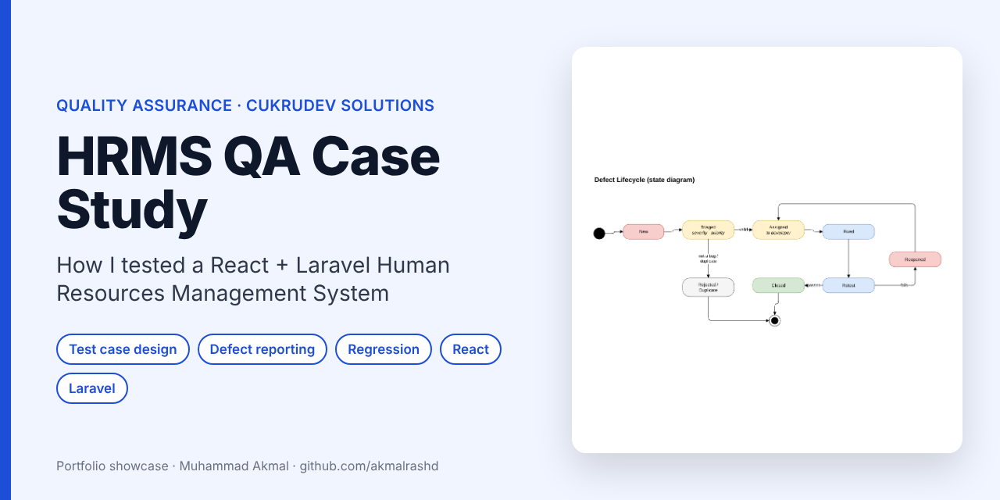
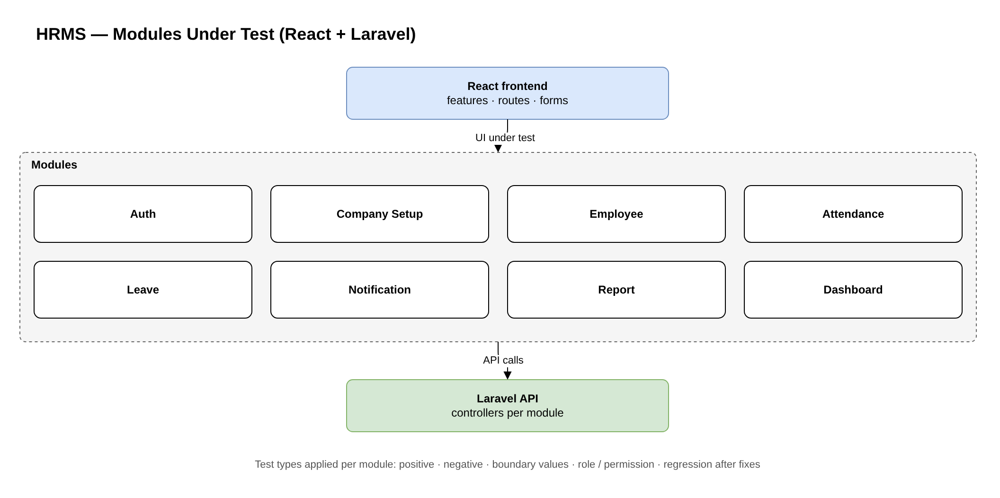
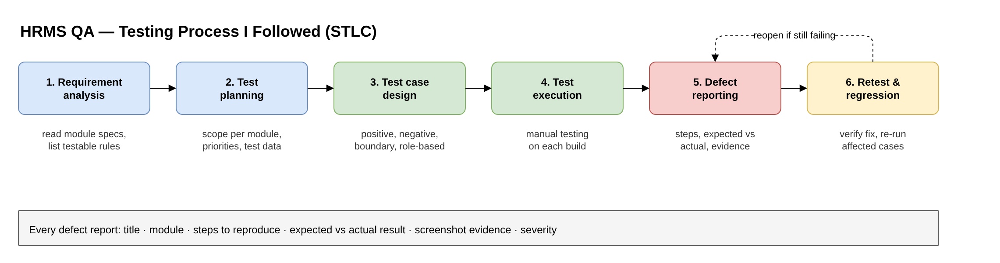
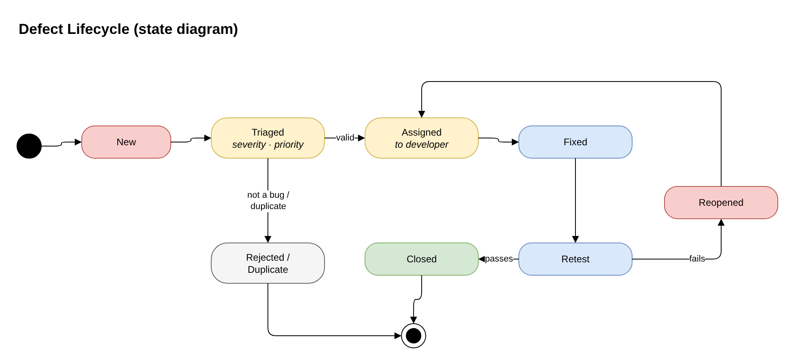

<p align="center"></p>

# HRMS — Quality Assurance Case Study

> **Case study, not source code.** The HRMS is a client system developed by CukruDev Solutions, so no code, screenshots or client data are shared here. This page explains **how I approached testing** it.

**Company:** CukruDev Solutions · **System:** Human Resources Management System (SaaS, React + Laravel)  
**Role:** Quality Assurance (QA) · **Period:** June 2026 – present

---

## Context

The HRMS was built by a team of developers working on separate modules (React frontend, Laravel API). My job was to test each module as it was delivered, find defects before the client did, and report them clearly so developers could fix them quickly.



## My testing process



1. **Requirement analysis** — read the module specification and turn each rule into something testable.
2. **Test planning** — decide scope, priority and the test data each module needs.
3. **Test case design** — positive, negative, boundary-value and role / permission cases.
4. **Execution** — run the cases on each new build.
5. **Defect reporting** — one clear report per issue (see template below).
6. **Retest and regression** — confirm the fix and re-run related cases so nothing else broke.

## Test case format

The rows below are **illustrative examples** of the format I use, not real client data.

| ID | Module | Scenario | Steps | Test data | Expected result | Type |
|---|---|---|---|---|---|---|
| TC-LV-01 | Leave | Apply leave within balance | Login as employee → Leave → Apply → Submit | 2 days, balance 10 | Request saved as *Pending*; balance unchanged until approved | Positive |
| TC-LV-02 | Leave | Apply leave above balance | Same as above | 12 days, balance 10 | Clear validation error; request not saved | Negative |
| TC-LV-03 | Leave | End date before start date | Same as above | Start 10/7, end 9/7 | Validation error on date range | Boundary |
| TC-AU-04 | Auth | Employee opens admin page by URL | Login as employee → open admin URL directly | — | Access denied (403) / redirected | Role |

## Defect report format

```
Title:      [Leave] Approved leave does not deduct balance
Module:     Leave            Build / date:  <build>
Severity:   High             Priority:      P1
Steps to reproduce:
  1. Login as manager
  2. Approve a 2-day leave request
  3. Login as the employee and open Leave balance
Expected:   Balance decreases by 2
Actual:     Balance unchanged
Evidence:   screenshot / screen recording, network response
```
<sub>Example format only.</sub>

## Defect lifecycle



## What I learned

- A good defect report is **reproducible in one try**: exact steps, data and expected vs actual result.
- **Negative and role-based tests** find more serious bugs than happy-path tests, especially in HR data where permissions matter.
- Regression testing after each fix matters when several developers change shared modules.
- Talking with developers early about unclear requirements prevents defects instead of only finding them.

## Related coursework

Software Quality Assurance (A) · Software Testing (A-) · Competency-Based Software Engineering Workshop: From Requirement to Testing (2nd place, 2026)

## Contact

**Muhammad Akmal bin Mohd Rashid** — Software Engineering student, UMPSA  
📧 work.akmalrashd@gmail.com · 💼 [linkedin.com/in/akmalrashd](https://www.linkedin.com/in/akmalrashd)
